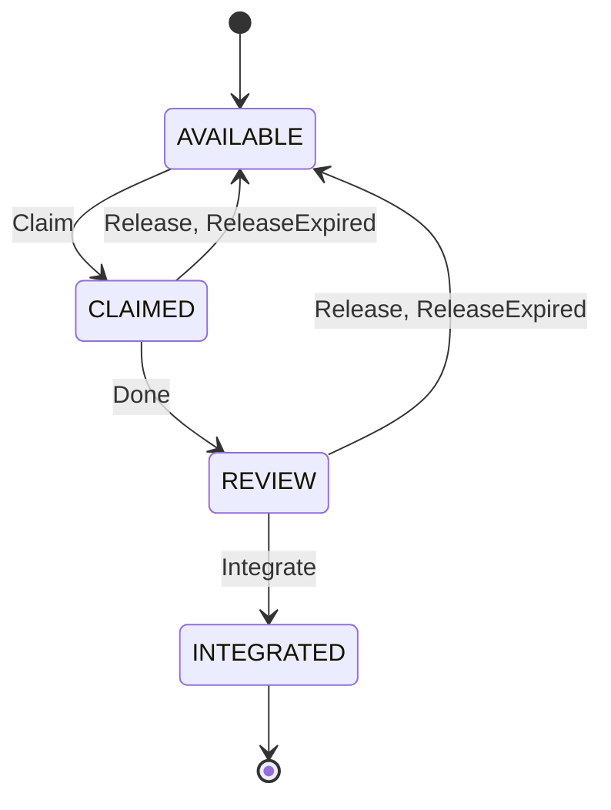
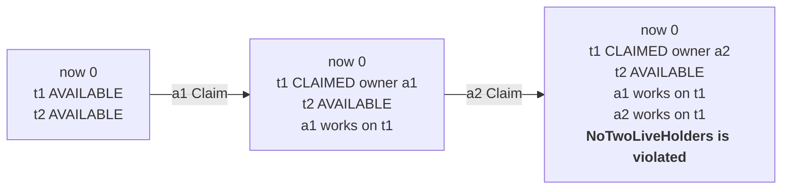

# The claims protocol, drawn from the model

Generated by `python3 scripts/tla_statechart.py` from TLC's output; do not edit by hand. The tla workflow
regenerates it and fails when it differs, so the picture cannot drift from `Claims.tla`.

## A task's states

TLC's whole state graph for one task and two agents (`ClaimsChart.cfg`), projected on the task's State. An arrow
lists every action that makes that change. BLOCKED and CANCELLED are not in the model.

## The shortest way to break it

`ClaimsBroken.cfg` drops the push's tip check. TLC searches breadth-first, so this is a shortest trace to a state
where NoTwoLiveHolders is violated. Each arrow is one step: the agents whose clone or belief changed, then the action.

